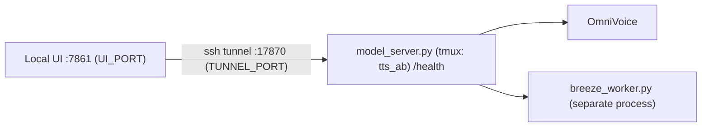

# Repository Guidelines

> **Minimal version.** The source code is only on H100 and hasn't been synced locally yet, so the architecture and conventions below are *not verified from code*. When the code is synced into this directory, update the sections marked **TBD**.

## H100 cluster — hard rules (always apply)

Full guides: `docs/H100_AGENT_RULES.md` (SSH) and `docs/H100_SLURM_GUIDE.md` (Slurm).
Read them before your first remote command in a session.

1. Remote access ONLY via `ssh -n H100 '...'` (or `scp` to `H100:`). No other alias, no IP,
   no `-M`, `-S`, `-F`, `-O exit`, `-o ControlMaster=...`, `-o ControlPath=...`.
2. Before the first remote command, and after any connection error, run `ssh -O check H100`.
   If it does not say `Master running`: STOP and ask the human.
3. Never retry after `Permission denied`, `Connection refused/closed/timed out`,
   or `already exists, disabling multiplexing`. Stop and report the exact message.
4. One SSH call per logical step: combine commands. No polling faster than 60 s. No `watch`.
5. Wrap every remote command in `timeout`. No interactive commands
   (`vim`, `less`, `top`, `srun --pty`, `sudo`, `git` without `--no-pager`, `salloc`).
6. GPU work only via `srun --overlap --jobid=<JOB_ID>` inside the allocation named in the full guide.
7. Never `sbatch` or `scancel` without explicit human approval. Never touch other users' jobs.
8. Only the designated installer agent may run `pip`/`uv pip`/`conda install`.

Canary: if the user types `h100-canary`, reply exactly `BLUEBIRD-42`.

## Architecture & Data Flow

- `model_server.py` runs on H100 in tmux session `tts_ab` and exposes `/health` (unverified this session — not read from current code; confirm before relying on it).
- The Breeze model runs in its own worker process (`breeze_worker.py`).
- **TBD**: request/response format, how the server talks to the worker, and where the UI code lives.

## Key Directories

| Path (on H100) | Purpose |
|---|---|
| `tts-ab-playground/` | Project root |
| `tts-ab-playground/logs/` | `model_server.log`, `breeze_worker.log` |

## Important Files

- `model_server.py`: the model server (entry point on H100).
- `breeze_worker.py`: the separate worker for Breeze TTS.
- `run_server.sh`: script that starts the server. **TBD**: arguments and environment variables.
- `server.addr`: server address file (contents not verified).
- `docs/H100_AGENT_RULES.md` / `docs/H100_SLURM_GUIDE.md`: canonical SSH/Slurm rules for agents — the source of truth behind the hard-rules block above.
- `data_audit/`: listen-and-audit UI for TTS manifests under `/mnt/data/users/anhnct/data` (FastAPI + vanilla JS, no new deps), `remap_nonverbal.py` (v2: filters `[breathing]`/`[throatclearing]` by source *form* recovered from `original_text`), and `remap_nonverbal_v3.py` (v3: layers per-*source-dataset* rules on top of v2's existing sigh-form filter — drops ALL `[breathing]` from `teacher_higgs3` and ALL `[throatclearing]` from `elevenlab_nv` outright, keeps `teacher_higgs3` throatclearing unconditionally; for the genuinely-mixed `nonverbal_38k`/`nonverbal`/`vieneu` throatclearing sources, decides per MARKER via a full, non-sampled `nv_gemini_audit` run passed through `--gemini-decisions`, with a coverage self-check that aborts if any expected row lacks a decision; VieNeu rows are a separate manifest merged in via `--vieneu` and deduped one-candidate-per-`slot_id`. Current output: 46,053/83,834 rows, 97.97h, `Nonverbal_VLSP4_Remap_v3`). Deployed at `/mnt/data/users/minhth21/data_audit/app`, serves on worker-5:8100 (tmux `data_audit`, job 21775); restart only via `restart_audit_ui.sh`. Guide: `docs/DATA_AUDIT_UI.md`.
- `nv_gemini_audit/`: Gemini-based blind audit pipeline that filters non-verbal-tagged TTS rows where the transcript was misread (`drop_transcript`, e.g. the tag name got spoken as text — "NV-Leak"), the audio has no sound at the tag (`drop_missing`), or a sound that doesn't match the tag (`drop_mismatch`). Deployed at `/mnt/data/users/minhth21/nv_gemini_audit`. `prepare_input.py` (sampling) and `decide.py` (scoring, policy + official VLSP label definitions in `tags.json`) run on H100; `gemini_audit.py` (the actual Gemini calls, needs `requests`) **must run locally** — H100 has no internet egress and no `GEMINI_API_KEY` (checked 2026-10-09). `run_audit.sh` orchestrates all of it in one command. Guide: `docs/NV_GEMINI_AUDIT.md`.
- `docs/BREEZE_NONVERBAL_INVESTIGATION.md`: why checkpoint-8000 gets non-verbal tags wrong (label mapping, unseen `[..]` syntax, missing eval results).
- `nv_lora/`: LoRA (p1 r32) fine-tune of the production Breeze checkpoint (exported nv01 checkpoint-8000) on the VieNeu `[throatclearing]` run `/mnt/data/users/anhnct/non-verbal-TTS/20261008-vieneu-nv-active21-audit-v5-refill`. That run's `samples/results.jsonl` holds 15,886 *candidates* for 5,000 slots (same sentence per slot, up to 81 retries), so `build_manifest.py` keeps one clip per slot: final gate (`gate-v5-fallback-standard-30.jsonl`) pass + acoustic screen (`acoustic-calibration-full-run-strict-v6-20261009.json`, ridge model trained on human listening labels) `nv`, highest score, duration/speaking-rate outliers dropped → 4,434 train / 99 val (10.7 h). `run.sh cache|smoke|train` mirrors nv01's `run.sh`; nv_lora01 ran inside job 21775 back when that job was this project's training sandbox (now 21775 is live `breeze_serve` inference — see `nv_lora/env.sh` below, `JOB` is required with no default on every invocation of `run.sh`). Training env is `/mnt/data/users/minhth21/conda_env/miniconda3/envs/breeze_tts` (transformers 4.57.3, peft, torch 2.9.1+cu128 — runs on driver 550 without the compat lib); the serving env `breeze312` cannot train or build the codec cache (no peft; transformers 5.12.1 breaks both `models/breeze_config.py` registration and `qwen_tts` import). Deployed at `/mnt/data/users/minhth21/breeze-tts/nv_lora`. `plot_train.py` plots a train.log (prefers the `step` field; older logs recover it from `epoch`). First run nv_lora01 (800 steps, checkpoints 200–800) is evaluated: cough at the tag eliminated, reading up, but spk_sim drops with steps and only ~45% of the VieNeu training clips are a true "ahem" per the judge — `docs/NV_LORA01_TRAINING_REPORT.md`.
- `nv_lora/runs/nv_lora02_p1-r32_from-vi33k_remap-v3-46k/`: LoRA (p1 r32) fine-tune from the production **vi33k** checkpoint `/mnt/data/users/anhnct/breeze-tts/outputs/exported/vi_all_20k_full_p2__checkpoint-33000` (not nv01-8000) on `data_audit/manifests/Nonverbal_VLSP4_Remap_v3/metadata.jsonl` (46,053 rows across all 4 VLSP tags — laughter/sniff/throatclearing/breathing — 97.97h, already in nv01 record shape, no extra filtering needed). `nv_lora/split_manifest.py MANIFEST OUT_DIR` does a plain sha256(id)-hash train/val split (same convention as `build_manifest.py`'s `is_val`), no row dropped: 45,810 train / 243 val. `run.sh` and `eval/run_gen.sh`/`score_tags.sh`/`score_reading.sh`/`paired_reading.py` are parametrized via env vars (`RUN`/`INIT`/`CONFIG`/`DATA_DIR`/`MAX_STEPS` for `run.sh`; `RUN`/`BASE`/`BASE_NAME`/`TRAIN_DIR`/`STEPS` for `run_gen.sh`; `RUN_NAME`/`MODELS` for the scorers) — all default to nv_lora01's original values, so unset they still reproduce nv_lora01. Shared path config (`REPO`/`PY_BREEZE`/`PY_TTS_EVAL`/`GENERATOR`/`EXPORTS`/`TE`/`BASE_CKPT`) lives in `nv_lora/env.sh`, sourced by every script that needs it; `JOB` (the Slurm job id for `srun --overlap --jobid=$JOB`) is deliberately **not** defaulted there and every GPU-touching script requires it explicitly (`JOB="${JOB:?set JOB=...}"`) — added 2026-10-10 after job 21775 (this project's original training/eval sandbox) silently became the live `breeze_serve` inference job; a stale default would have kept targeting it. Job ids churn: on 2026-10-11 the train/eval job on worker-2 was **22292** (22286 had expired) — check `squeue --me` each session; **job 21775 / worker-5** is live inference serving (do not target it with training/eval work). Trained batch 8 x accum 2 (global 16, LR 1e-4), 5600 steps (~1.96 epochs); completed with `train_loss=5.268`, `eval_val_sentences_loss` declining monotonically to step 5600, peak VRAM 57.7 GiB. **`save_total_limit: 4` with `save_steps: 400` kept only checkpoints 4400/4800/5200/5600** — earlier/mid ones were deleted during the run and can't be recovered or evaluated, unlike nv01 (kept 2k/4k/6k/8k) and nv_lora01 (kept all 4 of its shorter run); raise `save_total_limit` for any future long run where the checkpoint curve matters, since nv_lora01 found quality (spk_sim) can peak before the final step. `breeze_serve` was stopped via `stop_serve.sh` for this run (2026-10-09) and **has since been restarted — confirmed live on job 21775/worker-5 as of 2026-10-10** (the user is actively using it for inference; do not stop it or run GPU work against job 21775). `per_model_tag_table.py`/`per_model_position_table.py` derive per-model/per-position verdict tables from a `nv_gemini_audit` `results.jsonl` (decide.py's own summary.md only aggregates by tag, not by model). Results: unlike nv_lora01, tag accuracy improved AND spk_sim did not degrade (checkpoint-4400 best on every axis) — `docs/NV_LORA02_TRAINING_REPORT.md`; that report measured `[throatclearing]` only — sniff/breathing/laughter were never evaluated for 4400 until the 4-tag probe below.
- `nv_lora/eval/`: checkpoint evaluation for nv_lora runs, rebuilt on-H100 from the team's local-driven `breeze-tts-remote/eval_breeze.sh` (its `H100_TuAnh` alias is dead). `make_evalsets.py` builds `tc_val_99` (val sentences, seen VieNeu voices), `tc_clone_100` (100 `vi_clone_300` rows with `[throatclearing]` inserted, non-VieNeu clone refs), `sn_clone_100`/`br_clone_100`/`la_clone_100` (the **same** 100 sentences, positions, voices and refs with `[sniff]`/`[breathing]`/`[laughter]` instead — only the tag differs across the four sets, so tag confusion is measured under controlled conditions; `tc_clone_100` stayed byte-identical when these were added), and `vi_probe_100` (100 further, untagged, disjoint `vi_clone_300` rows — plain-reading-only baseline for the DPO probe below); `run_gen.sh` exports LoRA checkpoints (`breeze_train.export --policy p1` onto nv01-8000) into `/mnt/data/users/anhnct/breeze-tts/outputs/exported/` next to the team's other exports (group `ttsdata`, g+rw; the nv_lora01 exports were moved there on 2026-10-09 and `minhth21/breeze-tts/outputs/exported/` keeps symlinks to them) and generates with `breeze-tts-remote/remote/breeze_generate.py` (seed 42, no `--fast`), several streams in parallel on the one GPU (~25–60 s/item each under contention); `regen_baseline_vi.sh` regenerates the baseline's `vi_clone_300` with this repo/env (matches anhnct's older audio: 1-WER 0.9546 vs 0.9548); `score_tags.sh EVALSET` (local) feeds `nv_gemini_audit/run_audit.sh` with source `<model>|<evalset>`; `score_reading.sh` scores `vi_clone_300` with tts-eval; `paired_reading.py` gives paired bootstrap CIs (model − baseline on the same prompts; corpus 1-WER, pMOS = DNSMOS OVRL, spk_sim) — far tighter than the per-model CIs; `heldout_loss.py` reconstructs val-vs-train loss per checkpoint with `scripts/per_sample_loss.py`. Scoring env: `/mnt/data/users/minhth21/conda_env/miniconda3/envs/tts_eval` (anhnct's `tts_eval` and `omnivoice` env binaries lost their exec bit like `breeze_tts` — confirmed again 2026-10-10, `omnivoice`'s `python3.12` is `-rw-rw----`, no execute bit at all — so the native `tts_eval.nvpa`/OmniVoice MMS-forced-align+AST-AudioSet probe always reports `NVPA=n/a`); pMOS is DNSMOS, needs no download. nv_lora01 results: `docs/NV_LORA01_TRAINING_REPORT.md` §5.
  **DPO signal probe** (`dpo_probe_run_gen.sh`/`dpo_probe_score_reading.sh`/`dpo_probe_score_tags.sh`/`dpo_probe_analyze_spread.py`/`compute_nvpa.py`, 2026-10-10): before investing in a DPO fine-tune, checks whether one fixed checkpoint (nv_lora02 checkpoint-4400 by default) produces different-enough samples across seeds (42–49 by default) of the same prompt to actually form chosen/rejected pairs. Shares `evalsets/`/`gen/`/`runs/` with the checkpoint-sweep scripts above — outputs are named `seed_<seed>__<evalset>`, which never collides with `lora_<step>__`/`baseline_*__`, so nothing needed its own subfolder. `dpo_probe_run_gen.sh` generates `tc_clone_100` + `vi_probe_100` once per seed by default (`breeze_generate.py --seed` is per-invocation, not per-row, so this is one generator process per seed, not a seed column in the evalset). `dpo_probe_score_reading.sh` scores them with tts-eval as usual (1-WER/spk_sim/pMOS/duration per sample). `compute_nvpa.py` implements **NV Placement Accuracy (NVPA)**: "an NV event is correctly realized only when the required NV type is present at the intended position," range 0–1 — computed via `nv_gemini_audit` (not the broken OmniVoice probe above): each `[tag]` already gets a positional `<NVk>` placeholder spliced into the exact text position and the judge is asked only what it hears at that exact spot (`gemini_audit.py`'s `PROMPT_MARKED`), so position-correctness is inherent to the marker, not bolted on; NVPA then strictly requires the heard label be in `tags.json`'s `accept` set (the official VLSP definition), not the `review` data-compromise list. Computed from `results.jsonl`'s raw per-marker `heard`/`label`, deliberately **not** `decide.py`'s row-level `verdict`, since `verdict` also folds in the whole-sentence transcript gate — an unrelated reading slip elsewhere in the sentence must not zero out a correctly-placed NV sound (a real NV-Leak still shows up as `heard=false` at that marker, since the judge is asked only what it hears at that position, not what the transcript says, so leaks are still caught). `dpo_probe_analyze_spread.py` groups per-sample scores by prompt across seeds and flags a prompt "pairable" when at least one axis has a real spread: `wer` (word-error count differs by ≥1 word), `spk_sim` (differs by ≥0.03 — nv_lora01's observed real paired-CI-significant effect size was 0.013–0.026, so 0.03 is a deliberately conservative floor), `nvpa` (binary per seed, tagged evalsets only, any disagreement counts), `runaway` (any seed's seconds/word ≥2× that prompt's own median across its seeds — the documented no-EOS failure mode). Prompts with <2 non-missing seeds are excluded from the pairable rate and reported separately, not silently dropped.
  Runs from the **login node** on whichever job is free (`JOB` required, no default — see
  `nv_lora/env.sh`; as of 2026-10-11 that's **job 22292/worker-2**, job 22286 expired mid-run
  on 2026-10-11 and the run resumed on 22292 since `breeze_generate.py` skips existing wavs).
  Don't run these scripts from a shell already inside the allocation: they `srun --overlap`
  into the job themselves. Launch detached with the variables *inside* the tmux command —
  `VAR=x tmux new ...` does not reach the session:
  `tmux new -d -s NAME "JOB=22292 bash /abs/path/script.sh > /abs/path/logs/NAME.log 2>&1"`.
  `STREAMS` caps concurrent generator processes on the one GPU (default 4, ~9 GB each).
  `EVALSETS` selects which sets a run covers (default `tc_clone_100 vi_probe_100`); the
  **4-tag discrimination probe** (2026-10-11, the user's actual RL goal: keep the four tags
  apart — `[sniff]` not heard as breath, `[throatclearing]` a clear "ahem" not a faint one
  and not a cough) adds `EVALSETS="sn_clone_100 br_clone_100 la_clone_100" SEEDS="42 43 44 45"`.
  `dpo_probe_score_tags.sh` audits all four tag sets × seeds 42–45 in ONE Gemini run
  (`dpo_probe_nv4`, `--tags laughter,breathing,throatclearing,sniff`) and pushes
  `nvpa_<RUN_NAME>.jsonl` to H100 next to `runs/`; `compute_nvpa.py` rows carry each marker's
  `{expected, heard, hit, naturalness}`; `dpo_probe_analyze_spread.py` adds a **tag
  discrimination** report: expected-tag × heard-label confusion matrix, and per prompt across
  seeds *all-correct* / **mixed** (= a DPO chosen/rejected pair; the wrong seeds' labels are
  what DPO would push away from) / *all-wrong* (no chosen sample — a data/SFT problem RL
  can't fix), hit rate by tag position, and mean judge `naturalness` of hits vs misses (the
  closest existing proxy for "clear vs faint"; the judge has no dedicated prominence score —
  adding one means changing `gemini_audit.py`'s SCHEMA/PROMPT_MARKED and re-piloting).
  **Generation is not byte-reproducible even at a fixed seed**: measured (2026-10-10) that
  the same checkpoint, same row, same `--seed 42`, same flags produced same-length but
  non-identical audio on two separate runs (sha256 differs; ~95-97% of samples differ,
  max abs diff up to 76% of 16-bit full scale — those two stats alone look like "totally
  different audio", but they're not: for genuinely independent/uncorrelated same-power
  signals, `rms(diff)` ≈ `√2·rms(signal)` (≈ +3 dB); the measured
  `20·log10(rms(diff)/rms(a))` was **-28.2 dB and -14.7 dB** on two ids — both far
  *below* zero, which only happens when the two waveforms are strongly correlated (same
  content/timing, ~4-18% perturbation on top), not two independent generations. So: a
  **waveform-level perturbation on preserved content/timing — cause (decoder-level jitter
  vs. minor token differences) not isolated** by this measurement, and at this
  correlation level the effect on discrete metrics (word_errors, NVPA label) is very
  likely nil; a few-thousandths effect on `spk_sim` is plausible. Still: regenerate
  rather than symlink/reuse audio from a different invocation (the conservative choice
  regardless of cause), and don't assume all of a prompt's inter-seed spread is a clean
  seed effect — a small amount is this same-seed baseline perturbation.
  **Results (2026-10-12, checkpoint-4400, seeds 42–45, Gemini run `dpo_probe_nv4`, 1600
  rows, $7.31; summary `nv_lora/eval/spread_summary_nv4.md`):** NVPA hit rate by tag —
  throatclearing 71.5% (misses mostly **cough**, 70/400), laughter 63.5% (misses mostly
  `none`), breathing 26.2% (none 137, sigh 72, gasp 51), **sniff 12.5%** (heard as breath
  126/400, nothing at all 168/400). Per prompt across 4 seeds (all-correct / mixed = DPO pair
  / all-wrong): throatclearing 30/69/1, laughter 33/60/7, breathing 1/59/40, sniff 2/31/67 —
  so DPO has real pairs for throatclearing-vs-cough, laughter and breathing, but for sniff
  2/3 of prompts never produce a sniff at all (a data/SFT problem RL can't select its way
  out of). Beginning-position tags fail most (sniff 5%, breathing 15%, laughter 40% at the
  beginning). The spread report's `wer`/`spk_sim` axes fire on ~90% of prompts even for
  untagged `vi_probe_100` (ASR/ECAPA noise at those thresholds), so the overall "pairable %"
  is not informative — the `nvpa`/mixed column is the usable DPO signal. These NVPA counts
  ignore the transcript gate by design, so they differ slightly from `decide.py`'s
  gate-passed confusion table in the run's `summary.md`.

- `breeze-tts/`: local mirror of `/mnt/data/users/minhth21/breeze-tts` code (no `outputs/`, `serving/`, `.git`); edit here, push with `rsync --relative`, run tests on H100 (`python -m pytest -q -p no:cacheprovider tests` in the breeze_tts env, inside srun). `train.py` now supports `--eval-manifest NAME=PATH` (held-out loss incl. step 0; needs `label_names=["labels"]` because PeftModel hides it), `--sample-prompts` (audio at step 0 and every save, `breeze_train/samples.py`), `disable_tqdm`, `run_meta.json`, and train.log records with `step` and post-clip `grad_norm/<module>`; `BreezeTrainer` keeps train/eval loss components in separate ledgers (the old single ledger mixed eval batches into train logs). `scripts/per_sample_loss.py` gives per-clip loss by position/speaker for any checkpoint.
- `tts_playground/`: browser playground for the Breeze SGLang-Omni API (stdlib `server.py` serving `static/` and proxying `/api/{health,models,speech}` to `TTS_API`, default the user's forward `http://127.0.0.1:18000`; UI on `PLAYGROUND_PORT` 7862). Every `/v1/audio/speech` parameter is editable, WAV/MP3 or streamed PCM with TTFA, request JSON/curl copy, A/B history. The proxy forwards only data: URI `ref_audio` (the TTS server would read a path from its own disk). Copy on H100 at `/mnt/data/users/minhth21/tts_playground`. Usage: `docs/BREEZE_TTS_API.md` § Playground.

## Development Commands

- **TBD**: build/lint/test commands (not verified from code).
- Start/inspect the server: the user does this on H100 (tmux `tts_ab`, `run_server.sh`). The agent doesn't SSH in to run it outside the hard rules above.
- Before opening the local tunnel/UI, check that ports 7861 and 17870 are free: `ss -ltnp | grep -E ':(7861|17870)\b'`.

## Code Conventions & Common Patterns

- **Isolate environments per model**: `model_server.py` **must not** leak OmniVoice's `PYTHONPATH` into the Breeze worker process. When spawning the worker, pass a clean env. (Unverified this session, carried from earlier context.)
- Configure ports with environment variables `UI_PORT` (default 7861) and `TUNNEL_PORT` (default 17870).
- **TBD**: formatting, naming, error handling, and async patterns (not read from code).

## Runtime/Tooling Preferences

- Python on H100 (the GPU server). **TBD**: Python version, conda env, package manager.
- SSH tunnels/forwards are the **user's** responsibility, set up on the single shared master connection — agents don't open their own `-L`/`-M`/`-S` forwards (see hard rules above). If a forward is stuck, the user clears it; agents don't run `-O exit` or pass `-S`/`-M` themselves.

## Testing & QA

- No test suite has been found. **TBD** once the code is synced.
- Smoke check: `GET /health` through the tunnel (`curl http://127.0.0.1:17870/health`, once the user has the tunnel open), then generate one sample per model in the UI.
- Check logs: `logs/model_server.log`, `logs/breeze_worker.log`.