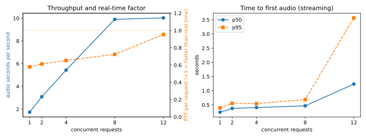
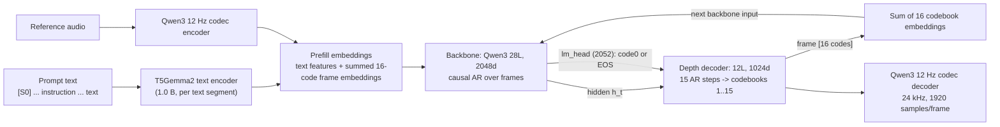
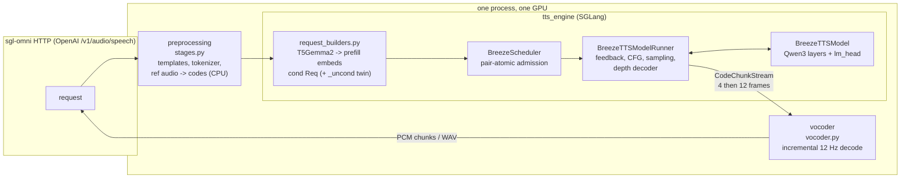
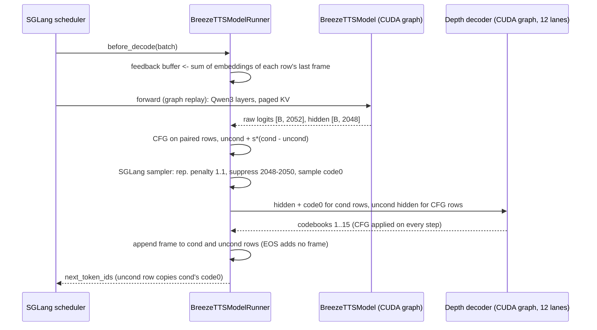
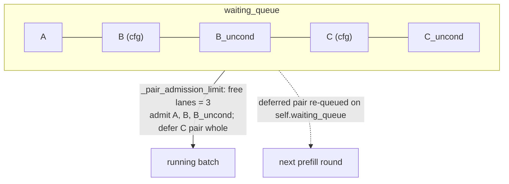
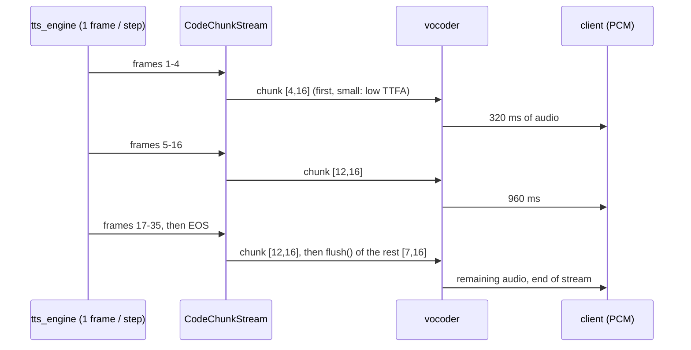
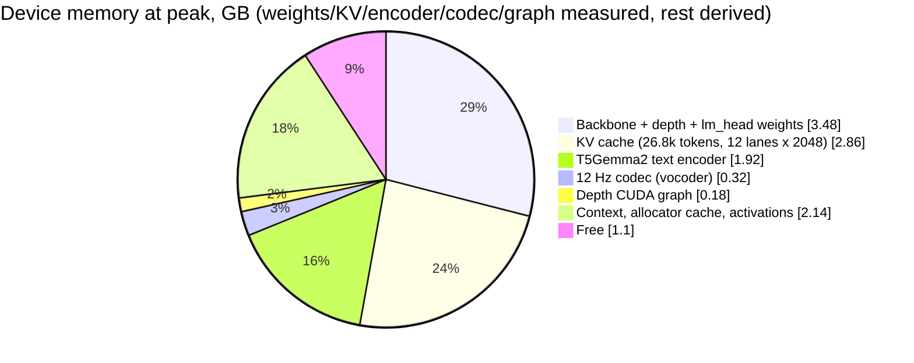
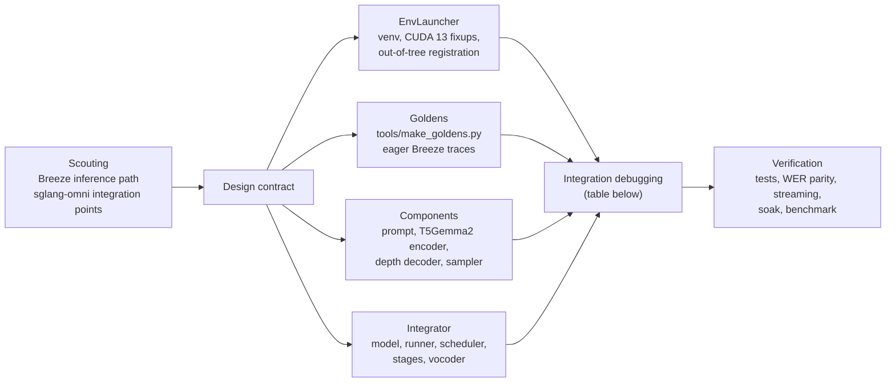

# Porting Breeze TTS 2 to SGLang-Omni

This document records how Breeze TTS 2 was made servable by
[SGLang-Omni](https://github.com/sgl-project/sglang-omni) 0.1.4 with continuous
batching, CFG and streaming. It explains why each piece looks the way it does
and how the result was verified. To install and run the server, see
[`../README.md`](../README.md).

**Result** on one RTX 4070 Ti (12 GB) with the base `breeze-tts-2` checkpoint:
at 8 concurrent streaming requests the server delivers **9.9 seconds of audio
per wall second**. Each stream still runs faster than real time (RTF 0.72) with
0.47 s median time to first audio. Whisper WER matches the reference `infer.py`,
and streamed PCM is identical to the buffered WAV.

---

## 1. What had to be served

Breeze TTS 2 is not a plain LLM. Each 80 ms audio frame takes three models:

| Fact (from `breeze-tts-2/config.json`) | Consequence for serving |
|---|---|
| Backbone is a Qwen3 adapter (rope θ = 1e6, no scaling) | SGLang's own `Qwen3ForCausalLM` layers work with paged KV. |
| Inputs are always embeddings (text features, or summed codes) | Prefill uses Omni's `OmniPrefillInputs`, and decode uses a per-step feedback buffer. |
| `lm_head` has 2052 outputs: 2048 codes, 3 reserved ids, EOS = 2051 | The reserved ids 2048-2050 are suppressed, and EOS is SGLang's stop token. |
| The 16 x 2051 frame table is tied to `depth_decoder.model.embed_tokens` | The table is stored only once in the checkpoint. |
| The codec is `qwen3_tts_tokenizer_12hz` | sglang-omni's own Qwen3-TTS incremental codec is reused. |
| CFG = `uncond + s*(cond - uncond)` on code0 **and** on every depth step; the negative prompt drops the instruction | CFG needs two KV sequences per request (section 4). |

## 2. Architecture inside SGLang-Omni

The code lives in its own package, `breeze_omni`, outside sglang-omni's tree.
sglang-omni discovers model families only inside its own package, so
`registration.py` registers the HF config, the pipeline config and the SGLang
model class. A `.pth` hook gated on `BREEZE_OMNI_REGISTER=1` runs that
registration in every spawned stage process. Nothing in `site-packages` is
patched.

### One decode step

CFG and suppression run in the runner rather than in `model.forward`. The
decode forward is replayed from an SGLang CUDA graph, so Python logic inside it
runs only once, at capture time.

## 3. Depth decoder: one graph, fixed lanes

The depth loop runs 15 steps x 12 layers per frame and is bound by weight
bandwidth. Its latency is flat from 1 to 8 rows, about 34-36 ms. Capturing one
graph per batch/CFG shape costs about 65 MB of device memory *each*, outside
PyTorch's allocator, and 48 shapes took 3.2 GB. The final design captures one
graph at startup over `MAX_RUNNING` lanes. Index tensors express the mix of
requests:

| lane | hidden | `partner` (whose logits are "uncond") | `owner` (whose token it feeds back) | scale |
|---|---|---|---|---|
| cond, no CFG | own | self | self | 1 |
| cond, CFG | own | its uncond lane | self | s |
| uncond | negative-prompt hidden | self | its cond lane | 1 |
| padding | 0 | self | self | 1 |

`guided = logits[partner] + scale * (logits - logits[partner])` is the identity
for unpaired lanes, so a single static graph serves every composition.

## 4. CFG as paired SGLang requests

A CFG request becomes two normal SGLang requests, `<rid>` (the prompt) and
`<rid>_uncond` (the negative prompt). Both use the paged KV, prefill and CUDA
graphs like any other request. This copies the pattern of sglang-omni's
`minimax_music3`, and Breeze additionally mixes CFG and non-CFG requests in the
same batch.

- **Enqueue** (`scheduler.py`): the builder threads append the cond request and
  its twin while holding the admission lock, so the two are always adjacent.
- **Admission**: a pair is admitted whole or not at all, so a pair is never
  split across prefill rounds.
- **Abort and finish**: aborting a request aborts its twin. Both lanes share one
  token stream and one `max_new_tokens`, so they finish on the same step.
- **Lanes**: `MAX_RUNNING` counts lanes, so a CFG request uses two.

## 5. Streaming: chunked engine -> vocoder

## 6. GPU memory budget (12 GB, defaults)

There is one invariant: `MAX_RUNNING x 2048` must fit in the KV pool. Without
it, SGLang can retract a running request and restart it after part of its audio
has already been streamed.

## 7. How the work was done

The port was split into four parallel workstreams that shared a written
contract (prompt/embedding/depth-decoder interfaces and a golden-file schema).
After that came one integration and debugging pass.

Problems found while bringing the server up, in order:

| # | Symptom | Root cause | Fix |
|---|---|---|---|
| 1 | The server returned audio, but the quality was wrong | The backbone frame table was randomly initialized. The checkpoint ties it to `depth_decoder.model.embed_tokens`, so `backbone_model.embed_tokens.*` does not exist | `frame_embedding` now aliases the depth table, and `load_weights` fails on unmapped or missing tensors |
| 2 | Concurrent requests failed with `operation not permitted when stream is capturing` | The depth graph was captured lazily on the engine thread while the vocoder thread used the GPU | Capture at startup with `capture_error_mode="thread_local"` |
| 3 | OOM after a few concurrent requests | The vocoder ran the incremental codec with autograd on, so the per-stream codec state pinned every chunk's activation graph (~28 MiB/frame) | `torch.inference_mode()` on decode, and `requires_grad_(False)` on the model |
| 4 | Only 0.7 GB free at startup | 48 per-shape depth graphs (~65 MB each) | One graph over fixed lanes (section 3) |
| 5 | CFG had no effect after the first frame | Guidance lived in `model.forward`, which is replayed from a CUDA graph | CFG moved into the runner's sampling hook, before the penalty and suppression |
| 6 | Repetition penalty applied twice | Omni's runner and SGLang's penalizer both applied it | Kept SGLang's penalizer only |
| 7 | Requests hung forever at 8 concurrent | SGLang rebinds `self.waiting_queue`, so requests deferred onto the old list object were lost | Deferred requests are re-queued on the live attribute, and twins are enqueued under the admission lock (`test_scheduler_pairs.py`) |
| 8 | Throughput plateaued with the vocoder seconds behind the engine | One vocoder message per 80 ms frame | `CodeChunkStream` with 4-frame and 12-frame chunks plus `flush` |
| 9 | The server silently came up on a random port after a restart | sgl-omni falls back to a free port | `serve.sh` waits for `PORT` to free up, then fails loudly |

## 8. Verification

| Check | How | Result |
|---|---|---|
| Prompt ids | `test_components_prompt.py` against goldens from `infer.py` code | exact, all 5 cases and negatives |
| Prefill embeddings | `test_components_text_encoder.py` | cosine > 0.999 |
| Depth decoder | `test_components_depth_decoder.py`: teacher-forced codes vs goldens; graph == eager; mixed CFG batch == row by row | 97.5 % top-1 (bf16), exact |
| CFG math and pairing | `test_integration_cfg.py`: guided code0 reproduces the golden CFG rollout; a split pair raises | pass |
| Scheduler | `test_scheduler_pairs.py`: deferred pairs survive admission and are never split | pass (fails on the old code) |
| Streaming | `test_live_streaming.py`: streamed PCM vs buffered WAV, greedy, same seed | same length, corr > 0.99 (4/4) |
| Quality parity | Same 30 requests through `infer.py` and the server, Whisper large-v3 | WER 0.236 vs 0.233 overall (table below) |
| Abort cleanup | 48 requests, every second one disconnects mid-stream | no errors; afterwards 0 running requests, KV usage 0.00, vocoder rows 0 |
| Leaks | 3 rounds of 24 requests at concurrency 12 | GPU memory flat (10 895 MiB) |

| kind | `infer.py` WER | server WER |
|---|---|---|
| plain EN | 0.022 | 0.011 |
| plain VI | 1.137 | 1.110 |
| voice design + CFG 4 | 0.000 | 0.000 |
| clone | 0.010 | 0.022 |
| clone + instruction + CFG 4 | 0.010 | 0.021 |

Vietnamese is unintelligible for **both** systems because the base checkpoint
does not speak Vietnamese. Serving a Vietnamese fine-tune (`MODEL=<exported
dir>`, see the main README's export step) changes the weights, not this code.

Benchmark (`bench.py`, 24 mixed requests per row: plain EN, plain VI,
design+CFG, clone, edit+CFG, streaming PCM, `MAX_RUNNING=12`):

| concurrency | req/s | audio s / wall s | RTF mean | TTFA p50 (s) | TTFA p95 (s) |
|---|---|---|---|---|---|
| 1 | 0.31 | 1.73 | 0.58 | 0.24 | 0.39 |
| 2 | 0.43 | 3.09 | 0.61 | 0.38 | 0.56 |
| 4 | 0.94 | 5.44 | 0.65 | 0.41 | 0.54 |
| 8 | 1.72 | 9.90 | 0.72 | 0.47 | 0.69 |
| 12 | 1.82 | 10.03 | 0.95 | 1.30 | 3.57 |

At 12 concurrent requests the 12 lanes are full, because CFG requests take two
each, so new requests queue.

To regenerate the chart, use the repository-root Breeze inference environment
for matplotlib (from this directory):
`../../.venv/bin/python tools/plot_bench.py ../../outputs/sglang_omni/bench docs/assets/bench.svg`.

## 9. Known limits

- A bare local path in `ref_audio` is read by the model stage. sglang-omni's
  API passes it through, as it does for its own Higgs and Qwen3-TTS
  integrations. Use data URIs, and do not expose the port to untrusted clients.
- Exact token-level parity with `infer.py` holds per component. End to end, a
  greedy rollout on the server matches the eager reference for the first frames
  and then diverges at bf16 near-ties, so the server-level acceptance check is
  WER parity.
- The depth loop is about 6 ms slower per frame than Breeze's own
  `--fast-depth-decoder` path. Under batching this cost is shared by every live
  request.
- Dual CFG (`cfg_scale_ref` / `cfg_scale_ins`) is rejected, the same as
  Breeze's fast streaming path.

## 10. File map

| File | Role |
|---|---|
| `bootstrap.sh`, `serve.sh` | default `.venv` or active Conda/PYTHON interpreter; SGLang-Omni 0.1.4 + CUDA 13.0 toolchain fixups and serving knobs |
| `breeze_omni/registration.py` | out-of-tree registration (HF config, pipeline config, SGLang model) |
| `breeze_omni/config.py`, `stages.py` | pipeline declaration; preprocessing (templates, reference encoding) |
| `breeze_omni/request_builders.py`, `payload_types.py` | request state, sampling params, cond/uncond SGLang `Req`s |
| `breeze_omni/scheduler.py` | pair-atomic CFG admission and abort |
| `breeze_omni/model.py`, `model_runner.py` | Qwen3 backbone + lm_head; feedback, CFG, sampling, depth decoding |
| `breeze_omni/engine_builder.py` | engine wiring, startup graph capture, `CodeChunkStream` |
| `breeze_omni/vocoder.py` | streaming and buffered 12 Hz decode |
| `breeze_omni/components/` | prompt templates, T5Gemma2 encoder, depth decoder, sampler |
| `tools/make_goldens.py`, `goldens/README.md` | eager reference traces from this repo's Breeze code |
| `tests/` | component, CFG, scheduler and live streaming tests |
| `bench.py`, `tools/plot_bench.py` | concurrency benchmark and its chart |
